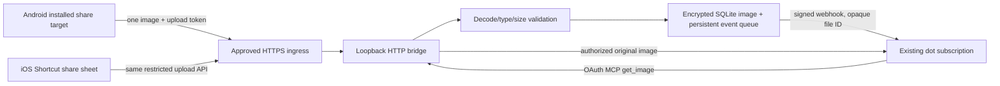

# Architecture



The web UI, OAuth endpoints, upload/status API, and authenticated MCP endpoint share one exact configured HTTPS origin. The Node listener itself is IPv4 loopback only, with an exact upstream Host check. `http_bridge.mjs` preserves binary request bodies; text-decoding an original image is not permitted.

## Modules

| Module | Responsibility |
| --- | --- |
| `store.mjs` | Scoped grants, encrypted images, one-dot subscriptions, expiry, durable queue, deduplication |
| `validate_image.py` | Pillow decode and PNG/JPEG/single-frame/pixel validation |
| `oauth.mjs` | Exact redirect allowlist, S256 PKCE, short-lived single-use code, origin-bound DB |
| `server.mjs` | HTTP routes, MCP Events handlers and read tool, callback verification, queue dispatch |
| `callback.mjs`, `signing.mjs` | Signed callback challenge and events, HTTPS-only public-address validation |
| `web/` | Android share target, local IndexedDB queue, preview, upload/status UI |
| `provision.mjs`, `launch.mjs` | Explicit local provisioning and loopback service lifecycle |
| `show_pairing.py` | Interactive user-only secret display; never capture its output |

## Upload contract

Both mobile clients use raw image bytes, not multipart:

```http
POST /api/upload
Authorization: Bearer <upload-only-token>
Origin: https://inbox.example.com
Content-Type: image/png
X-Share-ID: <16-to-100-character-alphanumeric-underscore-or-hyphen-ID>

<original PNG bytes>
```

JPEG uses `image/jpeg`. Maximum body is 8,388,608 bytes. The declared type must match the decoded file. HTTP 201 JSON returns `file_id` and `eventId`. Repeating the same ID and bytes returns the same identities while retained; different bytes with the same ID are rejected. Preserve the ID when retrying a potentially accepted upload.

`GET /api/status/<file_id>` with the same upload bearer returns `queued`, `callback_accepted`, or `delivery_failed`. It does not return image bytes. `callback_accepted` means the callback returned a successful HTTP status, not that an assistant processed the image.

MCP `/mcp` requires an OAuth read grant. It advertises `events`, provides `events/list`, `events/subscribe`, `events/unsubscribe`, and a read-only `get_image({file_id})` tool. `file.created` payloads contain only `inbox_id: personal` and opaque `file_id`; the envelope has a stable event ID. Transport protocol is MCP `2026-07-28` using the SDK's public custom-handler extension.

## Lifecycle and limits

- Image retention: one hour; cleanup on access/startup and every 30 seconds while running.
- Event queue: persisted, retried with bounded backoff and stable event identity, at most six attempts. 410/413 are terminal. A process crash can cause a duplicate callback; consumers must deduplicate event IDs.
- Grant lifetime: one day; subscriptions at most one hour and bound to a live grant. No refresh tokens or automatic grant renewal.
- One user and one dot callback, not a general multi-tenant or album-monitoring platform.
- Origin changes require new client registration/authorization and an isolated database. Persisting queue records does not preserve a vanished temporary hostname.
